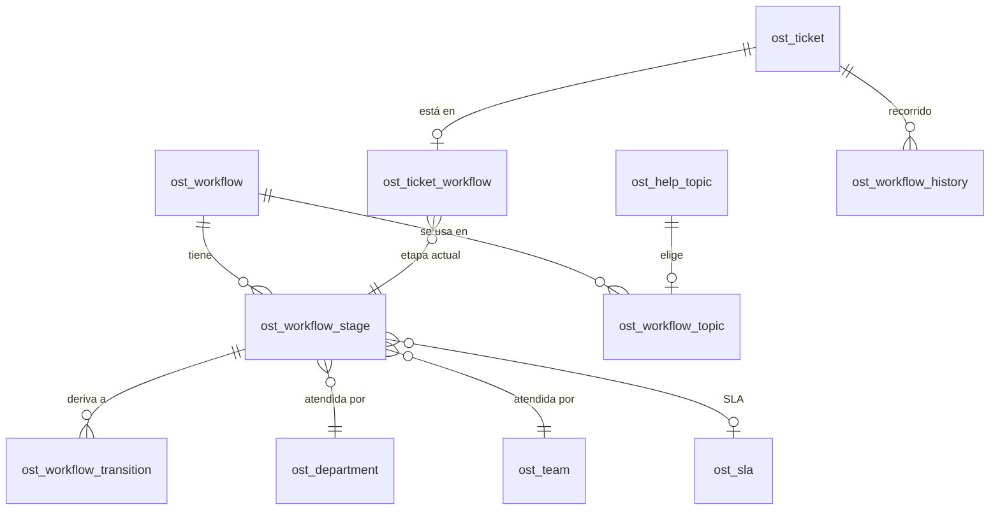

# Guía de implementación — osTicket 1.18 con mejoras

Esta guía explica cómo instalar en un servidor el código de la rama `feature/mejoras-osticket` (osTicket 1.18.4 más las mejoras), tanto en una instalación nueva como sobre una instalación de osTicket 1.18 que ya está en uso. Está dirigida al equipo técnico: administradores de servidores y de base de datos.

En resumen: se copia el código, se ejecuta una actualización de base de datos que **agrega 7 tablas y 3 columnas sin modificar las tablas de osTicket**, se programa el cron y se configuran las funciones desde el panel. La base de datos debe ser **MySQL 8.0 o MariaDB 10.2, o superior**.

- Manual de uso de cada función: [manual-usuario.md](manual-usuario.md)
- Mejoras pendientes: [backlog.md](backlog.md)
- Entorno de desarrollo con Docker: [../docker/README.md](../docker/README.md)

## 1. Qué se instala

| Función | Dónde se usa | Cambios en base de datos |
| --- | --- | --- |
| Vacaciones con fecha de inicio y fin | Admin Panel → Agents | Ninguno (usa `ost_staff.extra`) |
| Reparto automático de tickets en equipos (least busy, sequential, round robin), respaldo al líder, reintento y nota interna | Admin Panel → Teams | Ninguno (usa `ost_config`) |
| Flujos de atención por etapas, derivación, SLA por etapa y editor gráfico | Admin Panel → Manage → Workflows; ficha del ticket | 6 tablas nuevas (línea `workflow`) |
| Etapa como columna y filtro en las colas | Colas y búsqueda avanzada | Ninguno |
| Auditoría | Panel de agentes → Dashboard → Audit | 1 tabla nueva (línea `audit`) |
| Descarga de todos los adjuntos de una respuesta en ZIP | Hilo del ticket (agentes y portal) | Ninguno |
| Barra de búsqueda de tickets | Panel de agentes → Tickets | Ninguno |
| Dashboard público del portal | Portal de clientes → Dashboard | Ninguno |
| Reportes con exportación a CSV | Panel de agentes → Reports | Ninguno |
| Automatizaciones por tema de ayuda y campos de formulario | Admin Panel → Manage → Filters | 2 tablas nuevas (línea `automation`) |

## 2. Requisitos

| Componente | Requisito | Motivo |
| --- | --- | --- |
| PHP | 8.2 a 8.4 (se recomienda 8.4) | Igual que osTicket 1.18 |
| Extensión `mysqli` | Obligatoria | Igual que osTicket |
| Extensión `zip` | **Obligatoria** | Descarga de adjuntos en ZIP y exportación ZIP del ticket |
| Extensiones `gd`, `intl`, `mbstring`, `gettext`, `iconv`, `fileinfo`, `xml`, `phar`, `opcache` | Recomendadas | Igual que osTicket |
| APCu | Recomendada en producción | Caché de osTicket (ver sección 9) |
| Base de datos | **MySQL 8.0+ o MariaDB 10.2+** | El reporte «Stages» usa funciones de ventana (`LEAD … OVER`). osTicket solo pide MySQL 5.5 |
| Usuario de base de datos | Permisos `CREATE` y `ALTER` durante la actualización | Crea las tablas nuevas |
| Cron | Ejecutar `api/cron.php` cada 5 minutos | Vacaciones programadas, reintento de reparto y registro de auditoría |
| Servidor web | Apache o IIS, igual que osTicket | — |

Para comprobar la versión de la base de datos:

```sql
SELECT VERSION();
```

## 3. Componentes

### 3.1 Aplicación

El código está en el repositorio [erwinvr/osticket](https://github.com/erwinvr/osticket), rama `feature/mejoras-osticket`. La rama `develop` es osTicket 1.18.4 sin modificaciones.

**Archivos nuevos:**

| Archivo | Contenido |
| --- | --- |
| `include/class.workflow.php` | Modelos de flujos, etapas, derivaciones, historial y datos del dashboard del portal |
| `include/class.audit.php` | Registro de auditoría y consulta unificada de eventos |
| `include/class.reports.php` | Cálculo de los reportes |
| `include/class.automation.php` | Tema de ayuda y condiciones por campo de formulario de los filtros: validación, guardado y evaluación |
| `scp/workflows.php`, `include/staff/workflows.inc.php`, `include/staff/workflow.inc.php` | Administración de flujos y editor gráfico |
| `scp/audit.php`, `include/staff/audit.inc.php` | Pantalla de auditoría |
| `scp/reports.php`, `include/staff/reports.inc.php` | Pantalla de reportes |
| `dashboard.php`, `include/client/dashboard.inc.php`, `include/client/dashboard-data.inc.php` | Dashboard del portal de clientes |
| `include/upgrader/streams/streams.cfg` | Declara las líneas de actualización `core`, `workflow`, `audit` y `automation` |
| `include/upgrader/streams/workflow.sig`, `include/upgrader/streams/workflow/*.patch.sql` | Actualización de base de datos de los flujos |
| `include/upgrader/streams/audit.sig`, `include/upgrader/streams/audit/*.patch.sql` | Actualización de base de datos de la auditoría |
| `include/upgrader/streams/automation.sig`, `include/upgrader/streams/automation/*.patch.sql` | Actualización de base de datos de las automatizaciones |
| `setup/inc/streams/workflow/install-mysql.sql`, `setup/inc/streams/audit/install-mysql.sql`, `setup/inc/streams/automation/install-mysql.sql` | Esquema para instalaciones nuevas |

**Archivos de osTicket modificados:**

| Archivo | Cambio |
| --- | --- |
| `include/class.ticket.php` | Entrada al flujo, derivación, SLA por etapa, reparto en equipos, modo fijo, ZIP de adjuntos; pasa a los filtros los valores tipados de los formularios |
| `include/class.filter.php` | Los filtros evalúan también el tema de ayuda y las condiciones por campo; mensaje cuando un filtro no tiene acciones |
| `include/class.staff.php` | Vacaciones con fechas |
| `include/class.team.php` | Modos de reparto, respaldo al líder, reintento |
| `include/class.cron.php`, `scp/autocron.php` | Tareas de cron nuevas |
| `include/class.queue.php`, `include/class.search.php` | Criterio de contenido, campo «Stage», barra de búsqueda y conteo de resultados |
| `include/class.nav.php` | Menús nuevos (Workflows, Audit, Reports, Dashboard del portal) |
| `include/class.osticket.php` | Activa el registro de auditoría en cada petición |
| `include/class.upgrader.php` | **Corrección** para que la actualización funcione con varias líneas (ver sección 10) |
| `include/class.schedule.php` | **Corrección** de la zona horaria de los horarios de SLA (ver sección 10) |
| `scp/tickets.php`, `tickets.php` | Derivación, búsqueda y descarga ZIP |
| `include/staff/filter.inc.php` | Tema de ayuda y bloque «Form field conditions» en la ficha del filtro |
| `include/staff/*.inc.php`, `include/staff/templates/*.tmpl.php`, `include/client/*` | Pantallas |
| `assets/default/css/theme.css` | Ícono del menú Dashboard del portal |

Los archivos `docker/`, `docker-compose.yml` y `docs/` son del entorno de desarrollo y la documentación. `manage.php deploy` los copia igual, así que hay que **eliminarlos de la carpeta pública después de desplegar** (secciones 5 y 6): `docker/README.md` contiene contraseñas de prueba.

### 3.2 Base de datos

osTicket actualiza su base de datos con **líneas de actualización** (*streams*). Cada línea tiene una firma, guardada en `ost_config` (clave `schema_signature`), y una cadena de parches. Las mejoras usan tres líneas propias, separadas de la oficial (`core`), para no interferir con las futuras actualizaciones de osTicket.

| Línea | Firma final | Contenido | Parches para instalaciones existentes |
| --- | --- | --- | --- |
| `core` | `5fb92bef17f3b603659e024c01cc7a59` | Esquema oficial de osTicket 1.18.4 | Sin cambios |
| `workflow` | `9ecaaa6551e64f739f9d94f2f6dc05fa` | Flujos, etapas, derivaciones e historial | `d41d8cd9 → 5ec8959e` (crea las 6 tablas), `5ec8959e → 9ecaaa65` (agrega SLA y posición a las etapas) |
| `audit` | `9965208d8bc515df98f9111eb885548c` | Registro de auditoría | `d41d8cd9 → 9965208d` (crea la tabla) |
| `automation` | `c23c7f14cb412c2f64b45ad444fe4a38` | Tema de ayuda y condiciones por campo de los filtros | `d41d8cd9 → c23c7f14` (crea las 2 tablas) |

`d41d8cd9` es la firma con la que osTicket identifica una línea que todavía no está instalada.

## 4. Diccionario de datos

Todas las tablas usan el prefijo configurado en osTicket (por defecto `ost_`) y el juego de caracteres `utf8`, igual que las tablas de osTicket.



### 4.1 Línea `workflow`

**`ost_workflow`** — un flujo de atención.

| Columna | Tipo | Descripción |
| --- | --- | --- |
| `id` | int unsigned, PK | Identificador |
| `name` | varchar(128), único | Nombre del flujo |
| `flags` | int unsigned | Bits: `1` activo, `2` modo fijo (*Fixed*) |
| `notes` | text | Notas del administrador |
| `created`, `updated` | datetime | Fechas de creación y modificación |

**`ost_workflow_topic`** — qué temas de ayuda usan cada flujo. Un tema solo puede estar en un flujo.

| Columna | Tipo | Descripción |
| --- | --- | --- |
| `topic_id` | int unsigned, PK | Tema de ayuda (`ost_help_topic.topic_id`) |
| `workflow_id` | int unsigned, índice | Flujo (`ost_workflow.id`) |

**`ost_workflow_stage`** — etapas de un flujo.

| Columna | Tipo | Descripción |
| --- | --- | --- |
| `id` | int unsigned, PK | Identificador |
| `workflow_id` | int unsigned, índice | Flujo |
| `name` | varchar(128) | Nombre de la etapa (lo ve el cliente en el portal) |
| `dept_id` | int unsigned | Departamento que atiende la etapa |
| `team_id` | int unsigned | Equipo que atiende la etapa |
| `flags` | int unsigned | Bits: `1` etapa inicial, `2` etapa final (cierra el ticket) |
| `sort` | int unsigned | Orden en la lista |
| `sla_id` | int unsigned | SLA de la etapa (`0` = sin SLA propio). Agregada por el parche `5ec8959e → 9ecaaa65` |
| `pos_x`, `pos_y` | int | Posición en el editor gráfico (`-1` = automática). Agregadas por el mismo parche |
| `created`, `updated` | datetime | Fechas |

**`ost_workflow_transition`** — derivaciones permitidas entre etapas.

| Columna | Tipo | Descripción |
| --- | --- | --- |
| `from_id` | int unsigned, PK | Etapa de origen |
| `to_id` | int unsigned, PK | Etapa de destino |

**`ost_ticket_workflow`** — flujo y etapa actual de cada ticket.

| Columna | Tipo | Descripción |
| --- | --- | --- |
| `ticket_id` | int unsigned, PK | Ticket |
| `workflow_id` | int unsigned | Flujo |
| `stage_id` | int unsigned, índice | Etapa actual |
| `updated` | datetime | Entrada a la etapa actual (de aquí cuenta el SLA de la etapa) |

**`ost_workflow_history`** — recorrido de cada ticket por las etapas.

| Columna | Tipo | Descripción |
| --- | --- | --- |
| `id` | int unsigned, PK | Identificador |
| `ticket_id` | int unsigned, índice | Ticket |
| `from_stage_id`, `from_name` | int unsigned, varchar(128) | Etapa de origen (`0` y vacío = entrada al flujo) |
| `to_stage_id`, `to_name` | int unsigned, varchar(128) | Etapa de destino |
| `staff_id` | int unsigned | Agente que derivó (`0` = sistema) |
| `comments` | text | Comentario de la derivación |
| `created` | datetime | Fecha |

Los nombres de etapa se guardan también como texto para que el historial se conserve aunque una etapa se renombre o se elimine.

### 4.2 Línea `audit`

**`ost_audit_log`** — eventos que osTicket no registra por sí mismo.

| Columna | Tipo | Descripción |
| --- | --- | --- |
| `id` | int unsigned, PK | Identificador |
| `category` | varchar(16), índice | `login`, `config` o `cron` |
| `action` | varchar(32) | Por ejemplo `login`, `failed`, `edited`, `vacation off`, `assigned`, `run` |
| `object_type`, `object_id`, `object_name` | varchar(32), int unsigned, varchar(255) | Objeto afectado (agente, equipo, flujo, ajuste…) |
| `staff_id`, `user_id`, `username` | int unsigned, int unsigned, varchar(128) | Quién lo hizo (`CRON` o `SYSTEM` si fue automático) |
| `description` | text | Detalle |
| `ip` | varchar(64) | Dirección IP, o `cli` |
| `created` | datetime, índice | Fecha |

La pantalla de auditoría combina esta tabla con datos que osTicket ya guarda: `ost_thread_event` (eventos de tickets), `ost_thread_entry` (mensajes y notas), `ost_workflow_history` (cambios de etapa) y `ost_syslog` (registro del sistema).

### 4.3 Línea `automation`

Amplía los filtros de tickets de osTicket (`ost_filter`) sin modificar sus tablas. Las reglas clásicas siguen en `ost_filter_rule` y las acciones en `ost_filter_action`.

**`ost_filter_topic`** — tema de ayuda al que se limita un filtro. Un filtro sin fila aquí se aplica a todos los temas.

| Columna | Tipo | Descripción |
| --- | --- | --- |
| `filter_id` | int unsigned, PK | Filtro (`ost_filter.id`) |
| `topic_id` | int unsigned, índice | Tema de ayuda (`ost_help_topic.topic_id`) |

**`ost_filter_condition`** — condiciones sobre campos de formulario.

| Columna | Tipo | Descripción |
| --- | --- | --- |
| `id` | int unsigned, PK | Identificador |
| `filter_id` | int unsigned, índice | Filtro (`ost_filter.id`) |
| `field_id` | int unsigned | Campo de formulario (`ost_form_field.id`) |
| `op` | varchar(16) | Condición: `equal`, `not_equal`, `contains`, `dn_contain`, `starts`, `ends`, `in`, `not_in`, `gt`, `lt`, `between`, `on`, `before`, `after`, `checked`, `unchecked` |
| `value` | text (JSON) | Valor: texto, número, fecha `Y-m-d`, lista de claves de opción, o `[desde, hasta]` en `between` |
| `sort` | int unsigned | Orden en la pantalla |

Al eliminar un filtro desde la pantalla se borran también sus filas en las dos tablas.

### 4.4 Datos en tablas existentes de osTicket

Algunas funciones no necesitan tablas propias y guardan su configuración en estructuras que osTicket ya tiene:

| Dónde | Clave | Contenido |
| --- | --- | --- |
| `ost_staff.extra` (JSON) | `vacation_start`, `vacation_end` | Fechas de vacaciones del agente (`Y-m-d`) |
| `ost_staff.onvacation` | — | Estado efectivo de vacaciones; el cron lo mantiene al día |
| `ost_config`, namespace `team.<id>` | `assign_mode` | Modo de reparto: vacío, `least_busy`, `sequential` o `round_robin` |
| | `member_order` | Orden de los miembros (lista JSON de ids) |
| | `last_assigned` | Último agente que recibió un ticket (round robin) |
| | `lead_fallback`, `retry_pending` | Respaldo al líder y reintento por cron (`0`/`1`) |
| `ost_config`, namespaces `workflow`, `audit` y `automation` | `schema_signature` | Firma de cada línea de actualización |
| `ost_queue_column` | — | Solo si un administrador crea la columna «Stage» desde la configuración de colas |

## 5. Instalación nueva

Para un servidor sin osTicket.

1. Cree la base de datos y su usuario:

   ```sql
   CREATE DATABASE osticket CHARACTER SET utf8mb4 COLLATE utf8mb4_unicode_ci;
   CREATE USER 'osticket'@'localhost' IDENTIFIED BY '<contraseña>';
   GRANT ALL PRIVILEGES ON osticket.* TO 'osticket'@'localhost';
   ```

2. Descargue el código:

   ```bash
   git clone -b feature/mejoras-osticket https://github.com/erwinvr/osticket.git
   cd osticket
   ```

3. Copie la aplicación a la carpeta pública del servidor web, incluida la carpeta del instalador:

   ```bash
   php manage.php deploy --setup /var/www/osticket/
   rm -rf /var/www/osticket/docker /var/www/osticket/docs /var/www/osticket/docker-compose.yml
   ```

4. Prepare el archivo de configuración:

   ```bash
   cd /var/www/osticket
   cp include/ost-sampleconfig.php include/ost-config.php
   chmod 0666 include/ost-config.php
   ```

5. Abra `https://<servidor>/setup/` en el navegador y complete el asistente. El instalador crea las tablas de las cuatro líneas (`core`, `workflow`, `audit` y `automation`) y registra sus firmas.
6. Proteja la configuración y elimine el instalador:

   ```bash
   chmod 0644 include/ost-config.php
   rm -rf setup/
   ```

7. Programe el cron (sección 7) y continúe con la configuración (sección 8).

## 6. Actualizar una instalación existente de osTicket 1.18

Para un servidor que ya tiene osTicket 1.18 en uso. Durante el paso 4, osTicket muestra el helpdesk fuera de línea hasta que termina la actualización de la base de datos: prevea una ventana de mantenimiento de unos minutos.

1. **Respalde** la base de datos y la carpeta de osTicket:

   ```bash
   mysqldump --single-transaction -u osticket -p osticket > osticket-antes-mejoras.sql
   tar czf osticket-codigo-antes-mejoras.tgz /var/www/osticket
   ```

2. Compruebe que la base de datos cumple el requisito de versión (`SELECT VERSION();` ≥ MySQL 8.0 o MariaDB 10.2).
3. Descargue el código y despliéguelo **sin** la carpeta del instalador. `deploy` conserva `include/ost-config.php`:

   ```bash
   git clone -b feature/mejoras-osticket https://github.com/erwinvr/osticket.git
   cd osticket
   php manage.php deploy -v /var/www/osticket/
   rm -rf /var/www/osticket/docker /var/www/osticket/docs /var/www/osticket/docker-compose.yml
   ```

   Para ver antes qué archivos se copiarían, agregue `--dry-run`.

4. Aplique la actualización de base de datos, por una de estas dos vías:
    - **Desde el navegador:** entre al panel de agentes con un administrador. osTicket muestra que hay una actualización pendiente; siga el asistente hasta el final.
    - **Desde la consola:**

      ```bash
      cd /var/www/osticket
      php manage.php upgrade
      ```

      La salida esperada es:

      ```
      ... v1.18.4-workflow
      ... v1.18.4-workflow2
      ... v1.18.4-audit
      ... v1.18.4-automation
      Yay! All finished!
      ```

5. Verifique las firmas (sección 9.1).
6. Si copió los archivos con otro método distinto de `manage.php deploy`, reinicie PHP o vacíe APCu (sección 9.2).
7. Programe el cron (sección 7) y continúe con la configuración (sección 8).

## 7. Cron

Varias funciones dependen del cron de osTicket. Programe en el servidor, con el usuario del servidor web:

```bash
*/5 * * * * php /var/www/osticket/api/cron.php
```

| Tarea | Qué hace |
| --- | --- |
| Vacaciones programadas | Activa y desactiva el modo vacación según las fechas |
| Reparto de pendientes | Reparte los tickets de equipo sin agente cuando hay un miembro disponible (si el equipo lo tiene activado) |
| Auditoría | Registra cada ejecución y las acciones anteriores |

Sin cron, estas tareas solo se ejecutan con el autocron de osTicket, es decir, mientras hay agentes usando el panel.

## 8. Configuración posterior

Las funciones llegan desactivadas o vacías. El orden recomendado:

1. **Agentes y equipos** (Admin Panel → Agents): verifique que cada agente tenga acceso a los departamentos de los equipos a los que pertenece.
2. **Equipos** (Admin Panel → Agents → Teams): elija el modo de reparto, ordene los miembros, elija un líder y active, si corresponde, el respaldo al líder y el reintento.
3. **Planes de SLA** (Admin Panel → Manage → SLA): cree los SLA que usarán las etapas.
4. **Flujos** (Admin Panel → Manage → Workflows): cree el flujo, sus etapas (departamento, equipo, SLA, inicial, final), asigne los temas de ayuda y dibuje las derivaciones en el diagrama.
5. **Colas** (Admin Panel → Settings → Tickets → Queues): agregue la columna «Stage» a las colas que la necesiten.
6. **Dashboard del portal:** es público. Revise que mostrar las cantidades por tema y etapa sea aceptable para la organización.

El detalle de cada paso está en [manual-usuario.md](manual-usuario.md).

## 9. Verificación

### 9.1 Base de datos

```sql
-- Firmas: deben coincidir con la tabla de la sección 3.2
SELECT namespace, value FROM ost_config WHERE `key` = 'schema_signature';

-- Tablas nuevas: 6 en la primera consulta y 1 en cada una de las demás
SHOW TABLES LIKE 'ost\_%workflow%';
SHOW TABLES LIKE 'ost\_audit\_log';
SHOW TABLES LIKE 'ost\_filter\_topic';
SHOW TABLES LIKE 'ost\_filter\_condition';

-- Columnas agregadas a las etapas
SHOW COLUMNS FROM ost_workflow_stage WHERE Field IN ('sla_id', 'pos_x', 'pos_y');
```

Desde la consola, `php manage.php upgrade` debe responder `No upgrade is pending for this account`.

### 9.2 Aplicación

| Prueba | Resultado esperado |
| --- | --- |
| Entrar al panel de agentes | Aparecen las pestañas **Reports** y, en Dashboard, la opción **Audit** (administradores) |
| Admin Panel → Manage | Aparece **Workflows** |
| Crear un ticket con un tema asignado a un flujo | El ticket muestra «Stage» con la etapa inicial y el recuadro **Workflow** |
| Derivar el ticket como agente asignado | Cambia de departamento y equipo; queda en el historial de etapas |
| Admin Panel → Manage → Filters → Add New Filter | Aparecen **Help Topic** y el bloque **Form field conditions**; al elegir un tema, la lista de campos muestra los de sus formularios |
| Responder con dos adjuntos | Aparece «Download all (2 files, ZIP)» y el ZIP se descarga |
| Pantalla Tickets | Aparece la barra de búsqueda con número, asunto, contenido y fechas |
| Portal de clientes | Aparece **Dashboard** en el menú |
| Ejecutar `php api/cron.php` | Dashboard → Audit muestra «Scheduled tasks executed» en la categoría Cron |

**Error «Model Ticket does not have a relation called workflow_state»:** osTicket guarda la definición de los modelos en APCu y solo la renueva al desplegar con `manage.php deploy` o al actualizar la base de datos. Si los archivos se copiaron de otra forma, reinicie PHP-FPM o Apache para vaciar la caché.

## 10. Correcciones a osTicket que conviene conocer

Dos archivos propios de osTicket se corrigieron porque impedían el funcionamiento de las mejoras. Al actualizar osTicket a una versión oficial nueva, revise si la versión nueva ya los corrige o si hay que volver a aplicarlos.

| Archivo | Problema en osTicket | Corrección |
| --- | --- | --- |
| `include/class.upgrader.php` | Con más de una línea de actualización, exigía parches pendientes en todas (también en las que ya estaban al día) y no pasaba a la siguiente línea en la misma ejecución | Ignora las líneas al día y avanza a la siguiente pendiente |
| `include/class.schedule.php` | Un horario sin zona horaria propia usaba la del agente conectado, así que el vencimiento del SLA dependía de quién hacía la acción | Usa la zona horaria del helpdesk. **Afecta a todos los tickets**, no solo a los de flujos |

## 11. Reversión

Si hay que volver atrás:

1. Restaure el código anterior desde el respaldo del paso 1 de la sección 6.
2. **Con la base de datos hay dos opciones:**
    - **Restaurar el respaldo:** vuelve todo al estado previo, pero **se pierden los tickets y cambios hechos después de la actualización**.
    - **Conservar la base actual:** las tablas nuevas no molestan al código anterior, que las ignora. Los tickets y datos creados después de la actualización se conservan; solo se pierden las funciones nuevas.

      **En este caso, antes del paso 1 desactive las automatizaciones** que combinan reglas clásicas con tema de ayuda o condiciones por campo. El código anterior ignora el tema y las condiciones, y aplicaría esos filtros solo por sus reglas clásicas, es decir, a más tickets de lo previsto. Las automatizaciones que solo tienen tema o condiciones dejan de aplicarse solas. Para listar las que hay que revisar:

      ```sql
      SELECT f.id, f.name FROM ost_filter f
      WHERE f.isactive = 1
        AND EXISTS (SELECT 1 FROM ost_filter_rule r WHERE r.filter_id = f.id)
        AND (EXISTS (SELECT 1 FROM ost_filter_topic t WHERE t.filter_id = f.id)
          OR EXISTS (SELECT 1 FROM ost_filter_condition c WHERE c.filter_id = f.id));
      ```

3. Reinicie PHP o vacíe APCu.

Las tablas nuevas se pueden eliminar después, si se decide no volver a instalar las mejoras:

```sql
DROP TABLE ost_workflow, ost_workflow_topic, ost_workflow_stage,
    ost_workflow_transition, ost_ticket_workflow, ost_workflow_history, ost_audit_log,
    ost_filter_topic, ost_filter_condition;
DELETE FROM ost_config WHERE namespace IN ('workflow', 'audit', 'automation') AND `key` = 'schema_signature';
```

## 12. Mantenimiento

- **Crecimiento de la auditoría:** `ost_audit_log` crece sin límite; todavía no hay limpieza automática (mejora 10 del [backlog](backlog.md)). Para limpiarla a mano, conservando por ejemplo 12 meses:

  ```sql
  DELETE FROM ost_audit_log WHERE created < NOW() - INTERVAL 12 MONTH;
  ```

- **Cambios futuros en las tablas:** si se modifica `setup/inc/streams/<línea>/install-mysql.sql`, hay que:
  1. actualizar `include/upgrader/streams/<línea>.sig` con el nuevo MD5 de ese archivo;
  2. agregar en `include/upgrader/streams/<línea>/` un parche `<firma anterior 8>-<firma nueva 8>.patch.sql` que aplique el cambio y termine registrando la nueva firma en `ost_config`.

  El procedimiento está detallado en [../docker/README.md](../docker/README.md).

- **Búsqueda por contenido y reportes:** recorren los mensajes y el historial sin índice de texto. Con muchos tickets pueden tardar más; está anotado como mejora 15 del [backlog](backlog.md).
