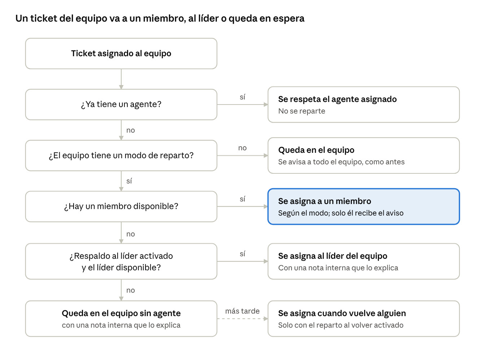
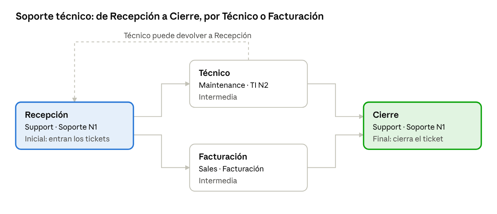
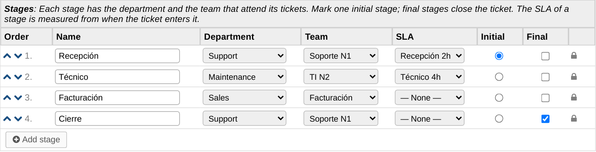
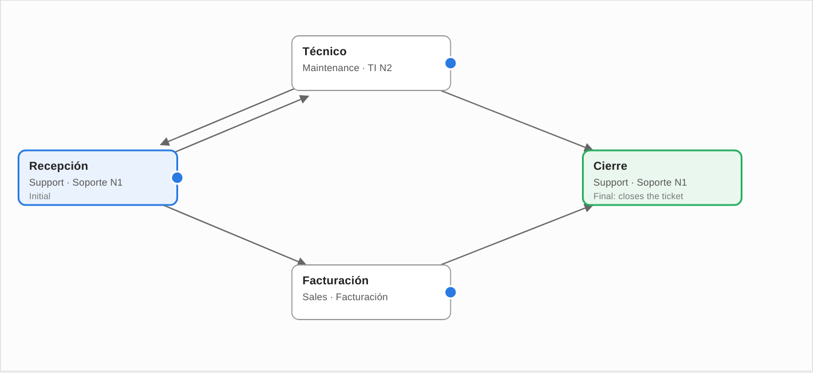
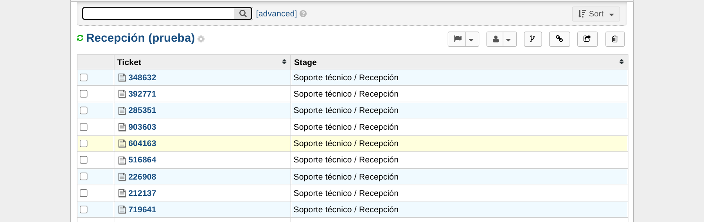
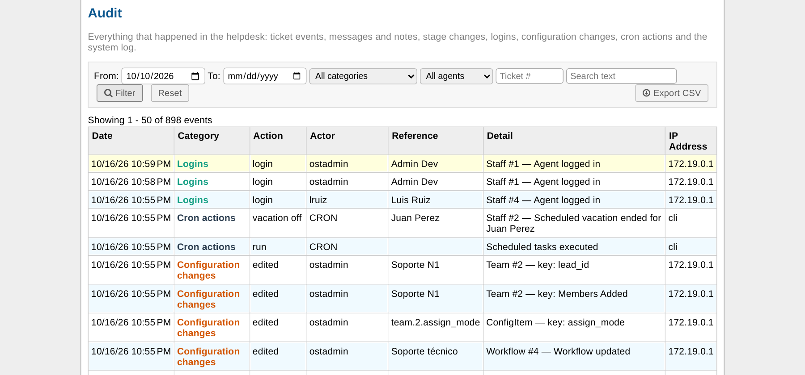
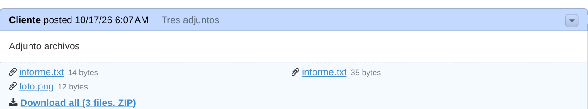
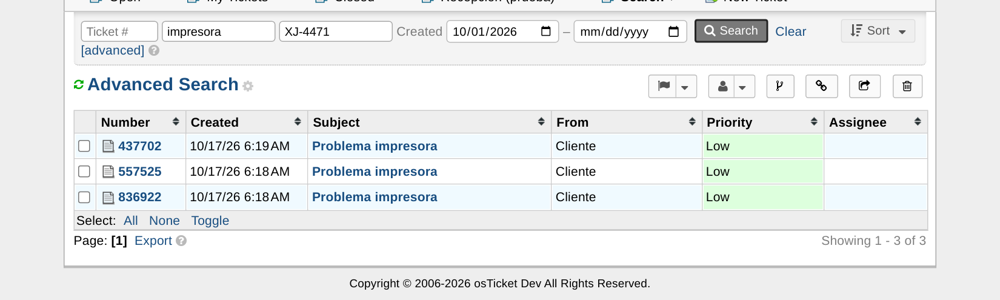
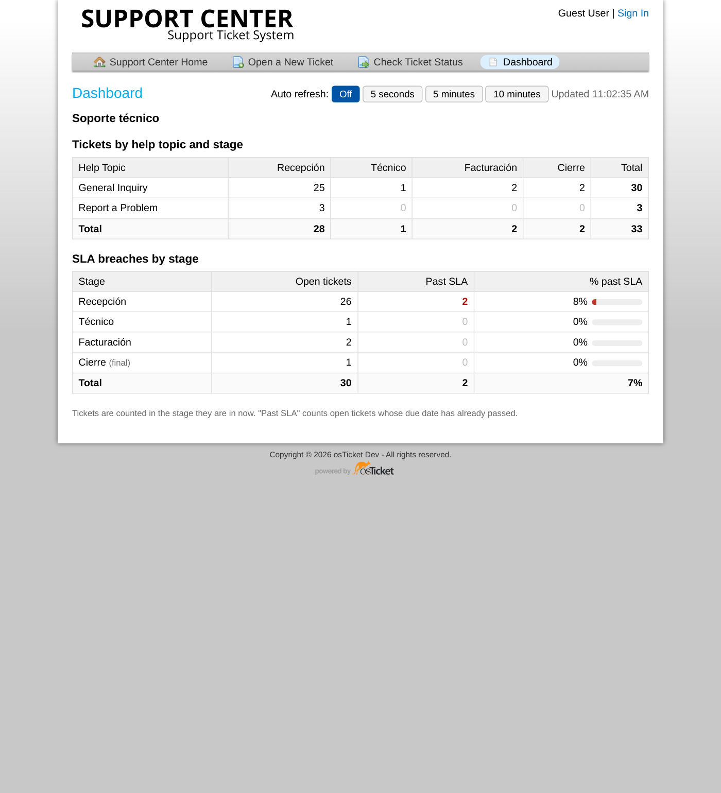

# Manual de usuario: vacaciones y reparto de tickets en osTicket

Última actualización: 16/10/2026 · Versión editable: [Claude Docs](https://claude.ai/code/artifact/b84f4015-e847-43fc-afa2-7f66130196b8)

## 1. Antes de empezar

Este manual explica, paso a paso, dos funciones nuevas de osTicket: programar las vacaciones de un agente con fecha de inicio y de fin, y repartir automáticamente los tickets de un equipo entre sus miembros.

**Para quién es:**

- **Administradores:** configuran vacaciones, equipos y flujos, y revisan la auditoría (secciones 2, 3, 5 a 9, 12 y 13).
- **Agentes:** consultan su propia vacación, ven qué tickets reciben, los derivan entre etapas, descargan adjuntos y buscan tickets (secciones 4, 8, 10, 11, 12, 14 y 15).

**Cómo entrar:**

1. Abra el panel de agentes de osTicket, en la dirección `/scp/` de su helpdesk.
2. Inicie sesión con su usuario y contraseña.
3. Los administradores ven el enlace **Admin Panel** arriba a la derecha. Desde ahí se hace toda la configuración de este manual.

**Qué quiere hacer:**

| Quiero… | Vaya a |
| --- | --- |
| Programar las vacaciones de un agente entre dos fechas | [2. Programar las vacaciones de un agente](#2-programar-las-vacaciones-de-un-agente) |
| Adelantar el regreso, cambiar las fechas o cancelar una vacación | [3. Cambiar, adelantar o cancelar una vacación](#3-cambiar-adelantar-o-cancelar-una-vacación) |
| Ver mi vacación o activar la vacación manual (agentes) | [4. Para agentes: su propia vacación](#4-para-agentes-su-propia-vacación) |
| Que un equipo reparta sus tickets entre sus miembros | [5. Activar el reparto automático en un equipo](#5-activar-el-reparto-automático-en-un-equipo) |
| Definir quién recibe primero los tickets | [6. Ordenar a los miembros del equipo](#6-ordenar-a-los-miembros-del-equipo) |
| Que los tickets no se queden sin dueño cuando todos están fuera | [7. Cuando nadie del equipo está disponible](#7-cuando-nadie-del-equipo-está-disponible) |
| Saber por qué un ticket le llegó a un agente | [8. Comprobar a quién se asignó un ticket](#8-comprobar-a-quién-se-asignó-un-ticket) |
| Que los tickets de un tema pasen por etapas definidas | [9. Diseñar un flujo de atención](#9-diseñar-un-flujo-de-atención) |
| Pasar un ticket a la siguiente etapa | [10. Derivar un ticket a otra etapa](#10-derivar-un-ticket-a-otra-etapa) |
| Saber qué ve el cliente de su ticket | [11. Qué ve el cliente](#11-qué-ve-el-cliente) |
| Ver o filtrar los tickets por etapa | [12. Ver la etapa en las colas y en la búsqueda](#12-ver-la-etapa-en-las-colas-y-en-la-búsqueda) |
| Revisar quién hizo qué y cuándo | [13. Auditoría](#13-auditoría) |
| Bajar de una vez todos los archivos de una respuesta | [14. Descargar todos los adjuntos en un ZIP](#14-descargar-todos-los-adjuntos-en-un-zip) |
| Buscar tickets por número, asunto, contenido o fecha | [15. Buscar tickets](#15-buscar-tickets) |
| Ver cuántos casos hay por tema y etapa, y cuántos vencieron el SLA | [16. Dashboard del portal](#16-dashboard-del-portal) |
| Entender un mensaje de error | [17. Preguntas frecuentes y solución de problemas](#17-preguntas-frecuentes-y-solución-de-problemas) |

La pantalla de osTicket está en inglés. Por eso este manual escribe los nombres de botones y campos tal como aparecen, por ejemplo **Vacation Mode**.

## 2. Programar las vacaciones de un agente

Con fecha de inicio y de fin, el sistema pone y quita la vacación solo: no hace falta acordarse de activarla el primer día ni de quitarla al volver. Mientras dura, el agente no recibe tickets ni alertas.

**Quién puede hacerlo:** un administrador.

### Pasos

1. Entre al **Admin Panel**.
2. En el menú superior, haga clic en **Agents** y luego en el submenú **Agents**.
3. Haga clic en el nombre del agente.
4. En la pestaña **Account**, baje hasta la sección **Status and Settings**.
5. Marque la casilla **Vacation Mode**. Se habilitan los campos de fecha.
6. En **From**, elija el primer día de vacaciones.
7. En **To**, elija el último día de vacaciones.
8. Haga clic en **Save Changes**, al final de la página.

Ambos días cuentan como vacación. Por ejemplo, del 3 al 7 de noviembre el agente vuelve a recibir tickets el 8.

### Cómo comprobar que quedó bien

- Arriba aparece el mensaje «Successfully updated this agent».
- Debajo de las fechas se lee el estado:
    - «Vacation scheduled to start on …» si la vacación empieza más adelante.
    - «On vacation until …» si ya empezó.
- En la lista de agentes, junto al estado, aparece «(vacation from …)» o «(vacation)».

### Vacación sin fechas

Si marca **Vacation Mode** y deja las dos fechas vacías, la vacación empieza al guardar y dura hasta que alguien desmarque la casilla. Es el funcionamiento que osTicket tenía antes.

### Reglas de las fechas

- Si pone una fecha, tiene que poner las dos.
- La fecha de fin no puede ser anterior a la de inicio.
- La fecha de fin no puede estar en el pasado.
- Inicio y fin pueden ser el mismo día, para una vacación de un solo día.

Si algo no cumple estas reglas, osTicket no guarda y muestra un mensaje en rojo junto a las fechas (vea la sección 17).

**Importante:** el cambio de estado lo hace una tarea automática de osTicket que corre cada pocos minutos. Si la vacación no se activa el día indicado, avise al área técnica para que revise el cron.

## 3. Cambiar, adelantar o cancelar una vacación

Todo se hace desde la misma pantalla de la sección 2: **Admin Panel → Agents → Agents →** (nombre del agente) **→ Account → Status and Settings**. Al terminar, haga clic en **Save Changes**.

| Quiero… | Qué hacer en la pantalla | Resultado |
| --- | --- | --- |
| Alargar la vacación | Cambie **To** por el nuevo último día de vacaciones | Sigue de vacaciones hasta la nueva fecha |
| Mover una vacación que todavía no empezó | Cambie **From** y **To** | Queda programada para las nuevas fechas |
| Que vuelva hoy mismo | Desmarque **Vacation Mode** | La vacación termina al guardar y las fechas se borran |
| Cancelar una vacación programada | Desmarque **Vacation Mode** | No se activará; las fechas se borran |
| Convertirla en vacación sin fecha de fin | Borre **From** y **To** y deje marcada la casilla | Activa hasta que alguien la desmarque |

Para adelantar el regreso no sirve poner una fecha de fin pasada: osTicket la rechaza. Desmarque la casilla.

### Después de que la vacación termina

Cuando pasa la fecha de fin, el agente vuelve a estar disponible sin que nadie haga nada. Al abrir su ficha, la casilla aparece desmarcada y las fechas vacías, lista para programar la próxima vacación.

## 4. Para agentes: su propia vacación

Cada agente puede ver en su perfil si tiene una vacación programada. Si un administrador puso fechas, el agente no puede cambiarlas; si no hay fechas, el agente puede activar y quitar su vacación manual.

### Ver si tengo una vacación programada

1. En el panel de agentes, haga clic en **Profile**, arriba a la derecha.
2. En la pestaña **Account**, baje hasta **Status and Settings**.
3. Debajo de **Vacation Mode** se lee, por ejemplo, «Scheduled by an administrator from 11/3/26 to 11/7/26».

En ese caso la casilla aparece gris y no se puede cambiar. Para mover o cancelar la vacación, pida a un administrador que siga la sección 3.

### Activar o quitar mi vacación manual

Solo es posible si no hay una vacación programada por un administrador.

1. Haga clic en **Profile** y vaya a **Status and Settings**.
2. Marque **Vacation Mode** para salir de vacaciones, o desmárquela al volver.
3. Haga clic en **Save Changes**.

Al volver de una vacación manual, osTicket muestra en el perfil el aviso «Welcome back… You are listed as 'on vacation'» hasta que la casilla se desmarca.

### Qué pasa mientras estoy de vacaciones

- No recibo tickets nuevos, ni por asignación manual ni por el reparto automático de los equipos.
- No recibo alertas por correo.
- Mis tickets ya asignados siguen a mi nombre.

## 5. Activar el reparto automático en un equipo

Con el reparto activado, cada ticket que llega al equipo se asigna enseguida a uno de sus miembros, en lugar de esperar a que alguien lo tome. Solo recibe tickets quien está activo, no está de vacaciones y tiene acceso al departamento del ticket.

**Quién puede hacerlo:** un administrador.

### Pasos

1. Entre al **Admin Panel**.
2. En el menú superior, haga clic en **Agents** y luego en el submenú **Teams**.
3. Haga clic en el nombre del equipo, o en **Add New Team** para crear uno.
4. En la pestaña **Team**, busque el campo **Ticket Assignment** y elija un modo (vea la tabla de abajo).
5. Vaya a la pestaña **Members** y compruebe que están todos los agentes que deben recibir tickets. Para agregar uno, elíjalo en **Select Agent** y haga clic en **Add**.
6. Si eligió *Sequential* o *Round robin*, ordene a los miembros (sección 6).
7. Haga clic en **Save Changes**.

### ¿Qué modo elijo?

| Modo en pantalla | A quién va cada ticket | Elíjalo si… |
| --- | --- | --- |
| **Disabled — assign to the team only** | A nadie: queda en el equipo hasta que alguien lo tome | Prefiere que los agentes tomen los tickets a mano (valor por defecto) |
| **Least busy** | Al miembro con menos tickets abiertos; si hay empate, al primero de la lista | Quiere repartir según la carga real de cada agente |
| **Sequential** | Siempre al primero de la lista que esté disponible; el siguiente solo si el primero no lo está | Hay un responsable principal y los demás son respaldo |
| **Round robin** | Por turnos, en el orden de la lista | Quiere que todos reciban la misma cantidad de tickets nuevos |

**Ejemplo con 3 miembros (María, Juan y Luis, en ese orden) y 4 tickets nuevos:**

| Modo | Ticket 1 | Ticket 2 | Ticket 3 | Ticket 4 |
| --- | --- | --- | --- | --- |
| Sequential | María | María | María | María |
| Round robin | María | Juan | Luis | María |
| Sequential, con María de vacaciones | Juan | Juan | Juan | Juan |
| Round robin, con Juan de vacaciones | María | Luis | María | Luis |

En *Least busy*, el resultado depende de cuántos tickets abiertos tiene ya cada uno. Los tickets cerrados no cuentan.

### Cuándo se reparte un ticket

- Cuando un agente asigna un ticket al equipo desde el panel.
- Cuando un ticket llega por email, portal o API y su tema de ayuda o un filtro lo envían al equipo.

Si el ticket ya tiene un agente asignado, se respeta y no se reparte. Las tareas (*tasks*) no se reparten, solo los tickets.

## 6. Ordenar a los miembros del equipo

El orden de la lista decide quién recibe primero en *Sequential*, el orden de los turnos en *Round robin* y quién gana un empate en *Least busy*.

### Pasos

1. Abra el equipo: **Admin Panel → Agents → Teams →** (nombre del equipo).
2. Vaya a la pestaña **Members**. Cada fila muestra un número (1., 2., 3.…), que es la posición del miembro.
3. Use la flecha **↑** para subir a un miembro un lugar, o **↓** para bajarlo.
4. Repita hasta que el orden sea el que quiere. Los números se actualizan solos.
5. Haga clic en **Save Changes**. El orden no se guarda hasta este paso.

### Bueno saber

- Un miembro nuevo se agrega al final de la lista.
- Junto al nombre de quien está de vacaciones aparece «(vacation)». No hace falta sacarlo de la lista: el reparto lo salta solo y lo vuelve a incluir cuando regresa.
- Para que un agente deje de recibir tickets del equipo, quítelo con el ícono de la papelera y guarde.

## 7. Cuando nadie del equipo está disponible

Si todos los miembros están de vacaciones o bloqueados, el ticket queda asignado al equipo, sin agente, con una nota interna que lo explica. Dos opciones evitan que se quede esperando: pasarlo al líder del equipo o repartirlo apenas vuelva alguien.

El ticket baja por las preguntas de la izquierda hasta encontrar un «sí». Si llega al final, espera en el equipo hasta que alguien lo tome, o hasta que vuelva un miembro si esa opción está activada.

### Pasos para activar las opciones

1. Abra el equipo: **Admin Panel → Agents → Teams →** (nombre del equipo).
2. En la pestaña **Team**, elija un líder en **Team Lead** si va a usar el respaldo al líder.
3. Debajo de **Ticket Assignment**, marque una o las dos opciones de la tabla. Solo aparecen si hay un modo de reparto elegido.
4. Haga clic en **Save Changes**.

| Opción en pantalla | Qué hace | Tenga en cuenta |
| --- | --- | --- |
| **If no member is available, assign to the team lead** | Si ningún miembro puede recibir el ticket, se asigna al líder del equipo | El líder también tiene que estar activo, sin vacaciones y con acceso al departamento. Puede no ser miembro del equipo |
| **Hand out open team tickets without an agent as soon as a member is available (cron)** | Cada pocos minutos, el sistema reparte los tickets del equipo que quedaron sin agente, empezando por el más antiguo | También reparte los tickets que ya esperaban sin agente antes de activar la opción |

### Ejemplo

El equipo «Soporte N1» tiene a María, Juan y Luis, los tres de vacaciones hasta el viernes. Llegan 5 tickets.

- **Sin opciones:** los 5 quedan en el equipo, cada uno con su nota. Alguien tiene que tomarlos a mano.
- **Con respaldo al líder:** los 5 van al líder del equipo, si está disponible.
- **Con reparto apenas vuelva alguien:** quedan en espera. Cuando termina la vacación de María, el sistema le asigna los 5.

### Atención: el primero que vuelve recibe toda la cola

Con la segunda opción activada, todos los tickets en espera van al primer agente que vuelve, sea cual sea el modo, porque en ese momento es el único disponible. Si los miembros vuelven el mismo día, la cola se reparte entre ellos.

Si esto no le conviene, deje la opción apagada y reparta la cola a mano, o use el respaldo al líder. Está en estudio un límite de tickets abiertos por agente para evitarlo.

## 8. Comprobar a quién se asignó un ticket

Cada ticket repartido deja tres rastros: el agente asignado en la ficha del ticket, el registro en el historial y, si hizo falta, una nota interna con el motivo.

### Pasos

1. En el panel de agentes, abra el ticket desde la cola o el buscador.
2. En la parte superior, el campo **Assigned To** muestra el equipo y el agente, por ejemplo «Juan Perez / Soporte N1».
3. Baje por el hilo del ticket. Ahí aparecen los eventos de asignación: primero al equipo y luego al agente. La asignación automática figura a nombre de **Team Auto Assignment**.
4. Si el ticket no llegó a ningún agente o lo recibió el líder, verá también una nota interna titulada **Team Auto Assignment**.

| Nota interna | Qué significa | Qué hacer |
| --- | --- | --- |
| «No agent of team … was available (on vacation, locked or without access to the department). The ticket remains assigned to the team.» | Ningún miembro podía recibirlo y no había líder de respaldo disponible | Asignarlo a mano, o esperar al reparto automático si está activado (sección 7) |
| «No member of team … was available. Assigned to the team lead.» | Lo recibió el líder porque no había miembros disponibles | Nada; el líder puede reasignarlo si quiere |

### El correo de aviso

El agente elegido recibe el correo **Ticket Assigned to you**. El resto del equipo no recibe nada, para no llenar su bandeja con tickets que no le tocan.

Cuando el reparto está en *Disabled*, osTicket avisa a todo el equipo, como antes.

## 9. Diseñar un flujo de atención

Un flujo define las etapas por las que pasa un ticket de un tema de ayuda, por ejemplo Recepción → Técnico → Cierre. Cada etapa tiene un departamento y un equipo que atienden el ticket mientras está en ella. Desde cada etapa solo se puede derivar a las etapas que usted autorice, y al llegar a una etapa final el ticket se cierra.

**Quién puede hacerlo:** un administrador.

Cada caja es una etapa con su departamento y su equipo; cada flecha, una derivación permitida. Desde Recepción no se puede ir directo a Cierre, porque esa flecha no existe.

### Antes de empezar

- Cree los equipos de cada etapa y active su reparto automático (sección 5). Si no, el ticket llega a la etapa sin agente y alguien tiene que tomarlo a mano.
- Elija un líder en cada equipo: el líder puede derivar los tickets de su etapa aunque no los tenga asignados.
- Compruebe que los miembros de cada equipo tengan acceso al departamento de su etapa. Si no lo tienen, el reparto los salta.

### Paso 1: crear el flujo y sus etapas

1. Entre al **Admin Panel**.
2. En el menú superior, haga clic en **Manage** y luego en el submenú **Workflows**.
3. Haga clic en **Add New Workflow**.
4. En **Name**, escriba el nombre del flujo, por ejemplo «Soporte técnico».
5. En **Status**, deje **Active**.
6. En **Transfers**, elija **Free** o **Fixed** (vea la tabla de abajo).
7. En **Help Topics**, marque los temas de ayuda que seguirán este flujo.
8. En la tabla **Stages**, complete una fila por etapa:
    - **Name**: nombre de la etapa, por ejemplo «Recepción».
    - **Department** y **Team**: quién atiende la etapa.
    - **Initial**: marque la etapa por la que entran los tickets nuevos. Solo puede haber una.
    - **Final**: marque las etapas que cierran el ticket.
9. Para agregar otra etapa, haga clic en **Add stage**. Ordénelas con las flechas ↑↓ y borre las que sobren con la papelera.
10. Haga clic en **Create Workflow**.

En la columna **SLA** puede elegir un plan de SLA para la etapa (opcional; vea «SLA por etapa» más abajo).

El candado de la última columna indica que la etapa tiene tickets y no se puede quitar.

### Paso 2: definir las derivaciones permitidas

Las derivaciones se definen en el diagrama del flujo, arrastrando con el ratón.

1. Vuelva a abrir el flujo desde **Admin Panel → Manage → Workflows**.
2. Baje hasta **Workflow diagram**. Cada caja es una etapa: azul la inicial, verde las finales.
3. Para ordenar el dibujo, arrastre las cajas a donde quiera. Si suelta una caja encima de otra, vuelve a su lugar.
4. Para permitir una derivación, haga clic en el punto azul del borde derecho de la etapa de origen y, sin soltar, arrastre hasta la etapa de destino. Aparece una flecha.
5. Para quitar una derivación, haga clic en su flecha (se pone roja al pasar el ratón) y confirme.
6. Haga clic en **Save Changes**. Ni las flechas ni las posiciones se guardan hasta este paso.

Debajo del diagrama, la sección **Allowed derivations** muestra las mismas derivaciones como casillas; puede usar cualquiera de las dos, porque siempre están sincronizadas. Las etapas nuevas aparecen en el diagrama después de guardarlas. Las etapas finales no tienen punto azul, porque en ellas el ticket se cierra.

### Transferencias libres o fijas

| Opción | Qué pueden hacer los agentes | Elíjala si… |
| --- | --- | --- |
| **Free** | Derivar entre etapas y, además, transferir el ticket a otro departamento o asignarlo a otro equipo, como siempre | El flujo es una guía y a veces hay excepciones |
| **Fixed** | Solo derivar entre etapas. El botón **Transfer** no aparece y no se puede asignar el ticket a un equipo distinto del de su etapa | El recorrido debe cumplirse siempre |

En los dos modos se puede reasignar el ticket a otro agente dentro de la etapa.

### SLA por etapa

Cada etapa puede tener su propio SLA. El plazo empieza a contar **cuando el ticket entra en la etapa**, no cuando se creó el ticket.

| Al entrar a… | SLA del ticket | Desde cuándo cuenta |
| --- | --- | --- |
| Una etapa con SLA | El de la etapa | Desde que entró a la etapa |
| Una etapa sin SLA | El habitual del ticket: el del departamento, si no el del tema de ayuda, si no el SLA por defecto | Desde la creación del ticket, como siempre en osTicket |

Al derivar, osTicket recalcula el vencimiento y quita la marca de vencido si la tenía. El SLA cuenta en el horario del departamento: un SLA de 4 horas con horario de oficina puede vencer al día hábil siguiente.

### Reglas

- Cada tema de ayuda puede usar un solo flujo.
- La etapa inicial no puede ser final.
- No se puede quitar una etapa que tiene tickets: aparece con un candado en lugar de la papelera.
- Un flujo con tickets no se puede borrar. Desactívelo con **Status → Disabled**: los tickets nuevos ya no lo usan y los que ya estaban siguen su recorrido.
- El flujo se asigna al crear el ticket. Si después se cambia el tema de ayuda del ticket, el ticket sigue en su flujo original.

## 10. Derivar un ticket a otra etapa

Derivar pasa el ticket a la siguiente etapa de su flujo: el ticket cambia al departamento de esa etapa y su equipo lo reparte entre sus miembros. Solo se puede derivar a las etapas que el flujo permite desde la etapa actual.

**Quién puede hacerlo:** el agente asignado al ticket o el líder del equipo de la etapa actual.

### Pasos

1. Abra el ticket en el panel de agentes.
2. Debajo de los datos del ticket está el recuadro **Workflow**, que muestra el flujo y la etapa actual («current stage»).
3. En **Derive to**, elija la etapa siguiente. Las etapas que cierran el ticket dicen «(closes the ticket)».
4. Opcional: escriba un comentario para quien recibe el ticket. Se guarda como nota interna.
5. Haga clic en **Derive**.

### Qué pasa con el ticket

| Al derivar a… | Departamento | Equipo y agente | Estado |
| --- | --- | --- | --- |
| Una etapa intermedia | El de la nueva etapa | El equipo de la nueva etapa lo reparte; el agente anterior deja de tenerlo | Sigue abierto |
| Una etapa final | El de la etapa final | Queda en el equipo final, con usted como agente que lo cerró | Se cierra |

En los dos casos quedan registrados una nota interna «Ticket derived from … to …», con su comentario, y una fila en el historial de etapas.

### Ver el recorrido del ticket

En el recuadro **Workflow**, haga clic en **Stage history**. La tabla muestra cada cambio de etapa con fecha, etapa de origen, etapa de destino y agente. La primera fila, «Ticket opened», es la entrada al flujo.

### Si no aparece el botón Derive

- **Usted no es el agente asignado ni el líder del equipo:** el recuadro lo indica con «Only the assigned agent or the lead of the stage team can derive this ticket».
- **El ticket está cerrado:** los tickets cerrados no se derivan.
- **La etapa actual no tiene derivaciones permitidas:** pídale a un administrador que las configure (sección 9).

Para cerrar un ticket en la etapa final, osTicket aplica sus reglas habituales: no se puede cerrar si tiene tareas abiertas o campos obligatorios vacíos. En ese caso, la derivación no se hace y aparece el motivo.

## 11. Qué ve el cliente

El cliente ve en el portal en qué etapa está su ticket, con el nombre de la etapa tal como lo escribió el administrador. Por eso conviene usar nombres que el cliente entienda, como «En revisión técnica» en lugar de «N2».

### Cómo lo ve el cliente

1. El cliente entra al portal de osTicket e inicia sesión, o pide el enlace de acceso con su email y el número de ticket (**Check Ticket Status**).
2. Abre su ticket.
3. En los datos del ticket, debajo de **Department**, aparece **Stage** con el nombre de la etapa actual.

El cliente no ve el historial de etapas, los comentarios de derivación (son notas internas) ni los agentes involucrados. Los tickets que no siguen un flujo no muestran la línea **Stage**.

## 12. Ver la etapa en las colas y en la búsqueda

La etapa del ticket está disponible como el campo **Stage** en todos los lugares donde osTicket deja elegir campos: columnas de las colas, filtros de las colas, orden y búsqueda avanzada. Se muestra como «Flujo / Etapa», por ejemplo «Soporte técnico / Recepción».

### Agregar la columna Stage a una cola

**Quién puede hacerlo:** un administrador (para las colas de todos).

1. Entre al **Admin Panel**.
2. Vaya a **Settings → Tickets** y abra la pestaña **Queues**.
3. Haga clic en la cola, por ejemplo **Open**.
4. Abra la pestaña **Columns**.
5. En **— Add a column —**, elija **— Add New —**.
6. En la ventana **Add Queue Column**, escriba el nombre de la columna (por ejemplo «Etapa») y en **Primary Data Source** elija **Stage**. Haga clic en **Save**.
7. Haga clic en **Save Changes**.

La próxima vez, la columna ya creada aparece directamente en la lista **— Add a column —** de cualquier cola.

### Crear una cola por etapa

1. En **Admin Panel → Settings → Tickets → Queues**, haga clic en **Add New Queue**.
2. Escriba el nombre, por ejemplo «En revisión técnica».
3. En la pestaña **Criteria**, agregue el campo **Stage**, deje la condición **includes** y marque las etapas que quiere ver.
4. Haga clic en **Save Changes**.

Con la condición **has a value** la cola muestra todos los tickets que siguen un flujo; con **does not have a value**, los que no siguen ninguno. Con **does not include** puede excluir etapas.

### Buscar tickets por etapa (agentes)

1. En **Tickets**, haga clic en **[advanced]**, al final de la barra de búsqueda (vea la sección 15).
2. Agregue el campo **Stage** y elija las etapas.
3. Haga clic en **Search**.

Un agente también puede guardar la búsqueda como cola personal con **Add personal queue**, en el menú de **Tickets**.

## 13. Auditoría

La auditoría reúne en una sola lista todo lo que pasa en el helpdesk: quién hizo qué, cuándo y desde qué dirección IP. La lista va de lo más reciente a lo más antiguo.

**Quién puede verla:** solo los administradores. Para el resto de los agentes la opción no aparece.

### Cómo entrar

1. En el panel de agentes, haga clic en **Dashboard**.
2. En el submenú, haga clic en **Audit**.

### Qué registra

| Categoría | Qué incluye |
| --- | --- |
| **Ticket events** | Creación, asignación, transferencia, cierre, reapertura, edición y vencimiento de tickets y tareas |
| **Messages and notes** | Mensajes del cliente, respuestas de agentes y notas internas, con el comienzo del texto |
| **Stage changes** | Entrada de cada ticket a su flujo y cada derivación, con quién la hizo y su comentario |
| **Logins** | Inicios y cierres de sesión de agentes y clientes, e intentos fallidos con el usuario usado |
| **Configuration changes** | Cambios en agentes, equipos, departamentos, temas de ayuda, flujos y ajustes del sistema, con el dato que cambió |
| **Cron actions** | Cada ejecución del cron programado, vacaciones que empiezan o terminan y tickets pendientes repartidos |
| **System log** | El registro de sistema de osTicket: errores, advertencias y mensajes técnicos |

### Filtrar y buscar

1. Al abrir la pantalla se muestran los últimos 7 días. Cámbielo en **From** y **To**.
2. Opcional: elija una categoría, un agente, escriba un número de ticket o un texto para buscar.
3. Haga clic en **Filter**. **Reset** vuelve a los valores iniciales.

En la columna **Reference**, los números de ticket son enlaces: un clic abre el ticket.

### Exportar

Haga clic en **Export CSV** para descargar los eventos filtrados (hasta 10.000) en un archivo que se abre con Excel.

### Bueno saber

- El filtro por agente y el número de ticket no se aplican al **System log**, que no guarda esos datos.
- Los eventos de tickets, mensajes y cambios de etapa se muestran desde siempre. Los logins, cambios de configuración y acciones del cron se registran desde que se instaló esta función.
- Las acciones que el sistema hace solo figuran con el actor **SYSTEM**, **CRON** o **Team Auto Assignment**.

## 14. Descargar todos los adjuntos en un ZIP

Cuando un mensaje, una respuesta o una nota tiene dos o más archivos adjuntos, debajo de los archivos aparece el enlace **Download all (N files, ZIP)**. Con un clic se descargan todos juntos en un solo archivo ZIP.

### Pasos

1. Abra el ticket: los agentes desde el panel, los clientes desde el portal.
2. Busque en el hilo la respuesta o el mensaje con los archivos.
3. Haga clic en **Download all (N files, ZIP)**, debajo de la lista de archivos.
4. El navegador descarga un archivo llamado `ticket-<número>-attachments-<n>.zip`.

### Bueno saber

- El enlace solo aparece si hay al menos dos archivos; con uno solo, se descarga ese archivo como siempre.
- Si dos archivos tienen el mismo nombre, el segundo se guarda como «nombre (2)» para que no se pierda ninguno.
- Las imágenes pegadas dentro del texto no se incluyen; solo los archivos adjuntos.
- Los clientes solo pueden descargar los adjuntos de sus mensajes y de las respuestas que reciben, nunca los de las notas internas.
- Para bajar el ticket completo (conversación en PDF y todos los adjuntos), los agentes siguen teniendo la exportación ZIP del ticket en el menú de impresión.

## 15. Buscar tickets

En la pantalla **Tickets**, la barra de búsqueda permite combinar cuatro filtros: número de ticket, asunto, contenido y rango de fecha de creación. Solo hace falta completar los que necesite; los resultados cumplen todos los que haya completado.

### Pasos

1. En el panel de agentes, haga clic en **Tickets**.
2. En la barra de búsqueda, complete uno o varios campos:
    - **Ticket #**: todo o parte del número, por ejemplo «752».
    - **Subject**: palabras del asunto.
    - **Content**: un texto que aparezca en los mensajes, respuestas o notas del ticket (mínimo 3 caracteres).
    - **Created**: la fecha desde y la fecha hasta. Puede usar solo una de las dos.
3. Haga clic en **Search**.
4. Para volver a la cola normal, haga clic en **Clear**.

| Campo | Encuentra | Ejemplo |
| --- | --- | --- |
| Ticket # | Tickets cuyo número contiene lo escrito | «752» encuentra 557525 y 752130 |
| Subject | Tickets cuyo asunto contiene lo escrito | «impresora» encuentra «Problema impresora» |
| Content | Tickets con ese texto en cualquier mensaje, respuesta o nota, aunque sea parte de una palabra | «presora del pi» encuentra «La impresora del piso 3…» |
| Created | Tickets creados entre las dos fechas, ambos días incluidos | Del 01/09/2026 al 30/09/2026 |

### Bueno saber

- Los resultados incluyen tickets abiertos y cerrados, de todos los departamentos a los que usted tiene acceso.
- Los valores buscados quedan en la barra, para afinar la búsqueda sin volver a escribirlos.
- Debajo de la lista se indica cuántos tickets se encontraron. Si son más de 500, se indica «about 500» y conviene acotar la búsqueda.
- Para búsquedas más complejas (por agente, estado, etapa, campos personalizados…) sigue disponible **[advanced]**.

## 16. Dashboard del portal

El portal de clientes (Support Center) tiene una opción **Dashboard** en el menú superior. Muestra, para cada flujo activo, cuántos casos hay por tema de ayuda en cada etapa y cuántos tickets abiertos ya vencieron su SLA en cada etapa. Se puede actualizar solo cada 5 segundos, 5 minutos o 10 minutos.

**Quién puede verlo:** cualquiera que entre al portal, con o sin sesión. Solo muestra cantidades: ningún dato de tickets, clientes ni agentes.

### Pasos

1. Entre al portal de osTicket (la dirección principal del helpdesk).
2. En el menú superior, haga clic en **Dashboard**.
3. Opcional: en **Auto refresh**, elija cada cuánto se actualizan los números: **5 seconds**, **5 minutes** o **10 minutes**. Con **Off** no se actualiza solo.

La pantalla recuerda la frecuencia elegida en ese navegador. Junto a los botones se indica la hora de la última actualización.

### Qué muestra

| Tabla | Qué cuenta |
| --- | --- |
| **Tickets by help topic and stage** | Una fila por tema de ayuda y una columna por etapa del flujo: cuántos tickets están hoy en cada etapa. Incluye los cerrados en la etapa final. Con totales por fila y por columna |
| **SLA breaches by stage** | Por etapa: tickets abiertos, cuántos ya pasaron su fecha de vencimiento (**Past SLA**) y qué porcentaje representan |

### Bueno saber

- Cada ticket se cuenta en la etapa en la que está ahora, no en las que ya pasó.
- Solo aparecen los flujos activos y los temas de ayuda que tienen tickets.
- «Past SLA» usa la fecha de vencimiento del ticket: la fijada a mano si la hay, o la del SLA (por etapa, si la etapa tiene uno; vea la sección 9).
- La actualización automática solo recarga los números, no toda la página.

## 17. Preguntas frecuentes y solución de problemas

### Mensajes de error

| Mensaje en pantalla | Dónde aparece | Causa | Solución |
| --- | --- | --- | --- |
| End date is required when a start date is set | Ficha del agente | Puso fecha de inicio pero no de fin | Complete **To** |
| Start date is required when an end date is set | Ficha del agente | Puso fecha de fin pero no de inicio | Complete **From** |
| End date must be on or after the start date | Ficha del agente | El fin es anterior al inicio | Corrija las fechas |
| End date cannot be in the past | Ficha del agente | La fecha de fin ya pasó | Elija hoy o una fecha futura. Para terminar una vacación ya, desmarque **Vacation Mode** |
| Valid date required | Ficha del agente | La fecha no existe, por ejemplo 30 de febrero | Elija una fecha del calendario |
| Select a team lead to use as fallback | Ficha del equipo | Marcó el respaldo al líder sin elegir un líder | Elija uno en **Team Lead**, o desmarque la opción |

**Mensajes de los flujos:**

| Mensaje en pantalla | Dónde aparece | Causa | Solución |
| --- | --- | --- | --- |
| Add at least one stage | Ficha del flujo | El flujo no tiene etapas | Complete al menos una fila en **Stages** |
| Select the initial stage | Ficha del flujo | Ninguna etapa está marcada como **Initial** | Marque una |
| The initial stage cannot be a final stage | Ficha del flujo | La etapa inicial también está marcada como **Final** | Desmarque **Final** en esa etapa |
| Select a department / Select a team | Ficha del flujo | A una etapa le falta departamento o equipo | Complete la fila |
| Help topic "…" already uses workflow "…" | Ficha del flujo | Ese tema ya está en otro flujo | Quítelo del otro flujo o desmárquelo aquí |
| Stage "…" has tickets and cannot be removed | Ficha del flujo | Intentó quitar una etapa con tickets | Derive esos tickets a otra etapa primero |
| Only the assigned agent or the lead of the stage team can derive this ticket | Ficha del ticket | Usted no tiene el ticket asignado ni es líder del equipo | Pídale al agente asignado o al líder que lo derive |
| This ticket follows a fixed workflow. Use Derive to move it to another stage. | Transferir un ticket | El flujo es fijo | Use **Derive** (sección 10) |
| This ticket follows a fixed workflow and belongs to team … | Asignar un ticket a un equipo | El flujo es fijo | Asigne a un agente de ese equipo o derive el ticket |

### Preguntas frecuentes

**Un ticket llegó al equipo pero no se asignó a nadie. ¿Por qué?**

Revise, en este orden:

1. Que el equipo tenga un modo distinto de *Disabled* en **Ticket Assignment**.
2. Que el ticket no tuviera ya un agente: en ese caso no se reparte.
3. Que haya al menos un miembro activo y sin vacaciones.
4. Que esos miembros tengan acceso al departamento del ticket.

Si nadie cumplía, el ticket tiene una nota interna que lo indica (sección 8).

**Un agente recibe todos los tickets del equipo.**

El equipo está en *Sequential* y ese agente es el primero de la lista. Si quiere repartir, cambie a *Round robin* o *Least busy* (sección 5). También pasa si fue el primero en volver de vacaciones con el reparto automático activado (sección 7).

**Programé una vacación pero el agente sigue recibiendo tickets.**

Compruebe en su ficha que la vacación tenga las fechas correctas y que hoy esté dentro del período. Si es así, la tarea automática de osTicket puede no estar funcionando: avise al área técnica.

**El agente no puede quitarse la vacación desde su perfil.**

Es lo esperado cuando un administrador programó fechas. Un administrador debe desmarcar **Vacation Mode** en su ficha (sección 3).

**¿Puedo poner a un agente en dos equipos con reparto?**

Sí. Cada equipo reparte sus propios tickets por separado. En *Least busy* se cuentan todos los tickets abiertos del agente, de cualquier equipo.

**¿El reparto cambia tickets que ya tenían agente?**

No. Solo asigna tickets que no tienen agente.

**Un ticket nuevo no entró al flujo.**

Revise que el flujo esté en **Active**, que su tema de ayuda esté marcado en el flujo y que el flujo tenga una etapa **Initial**. Los tickets creados antes de configurar el flujo no entran solos.

**Derivé un ticket y ya no lo veo.**

La nueva etapa pertenece a otro departamento al que usted no tiene acceso. Es lo esperado: ahora lo atiende el equipo de esa etapa.

**¿Qué pasa si reabro un ticket cerrado en la etapa final?**

El ticket se reabre y sigue en la etapa final, que no tiene derivaciones. Para continuar el recorrido, un administrador debe permitir derivaciones desde una etapa no final, o el ticket se gestiona fuera del flujo si este es libre.

## 18. Historial de este manual

Este manual se actualiza cada vez que se agrega o cambia una función.

| Fecha | Cambio |
| --- | --- |
| 17/10/2026 | Dashboard del portal con casos por tema y etapa, vencimientos de SLA por etapa y actualización automática (sección 16) |
| 17/10/2026 | Nueva barra de búsqueda de tickets por número, asunto, contenido y fecha de creación (sección 15) |
| 17/10/2026 | Descarga de todos los adjuntos de una respuesta en un ZIP (sección 14) |
| 16/10/2026 | Editor gráfico de flujos y SLA por etapa (sección 9), etapa en colas y búsqueda (sección 12) y auditoría (sección 13) |
| 16/10/2026 | Flujos de atención por etapas: diseño del flujo (sección 9), derivar tickets (sección 10), etapa visible para el cliente (sección 11) y sus mensajes y preguntas frecuentes (hoy sección 17) |
| 16/10/2026 | Primera versión: vacaciones con fechas (secciones 2 a 4), reparto automático en equipos (secciones 5, 6 y 8), opciones para cuando nadie está disponible (sección 7) y preguntas frecuentes (hoy sección 17) |

**Estado:** todas las funciones están probadas en el entorno de pruebas. Todas están guardadas en el repositorio, en la rama `feature/mejoras-osticket`. Ninguna está instalada aún en el sistema de producción.

**Al instalar los flujos y la auditoría en producción:** osTicket mostrará que hay una actualización de base de datos pendiente. Un administrador debe completarla desde el panel (o el área técnica con `php manage.php upgrade`) antes de seguir usando el sistema.
